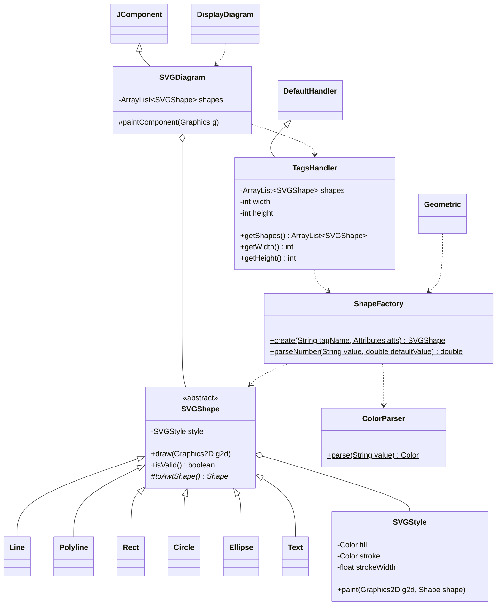

##  Procesamiento y visualización de archivos SVG con Java

Proyecto didáctico que muestra cómo leer documentos **SVG (Scalable Vector Graphics)** mediante el analizador XML **SAX**,
describir sus elementos, calcular propiedades geométricas y dibujar algunas figuras en una ventana **Swing/Java 2D**.

Los gráficos vectoriales escalables o gráficos vectoriales redimensionables (del inglés: Scalable Vector Graphics (**SVG**) 
es un formato de gráficos vectoriales bidimensionales, tanto estáticos como animados, en formato de lenguaje de marcado 
extensible XML (Extensible Markup Language), es decir que se compone por código y cuya especificación es un estándar 
abierto desarrollado por el W3C desde 1999 ([Wikipedia](https://es.wikipedia.org/wiki/Gr%C3%A1ficos_vectoriales_escalables)).

Para conocer más sobre el formato SVG, puedes visitar:
- La página oficial del W3C: [SVG 1.1 Specification](https://www.w3.org/TR/SVG11/).
- La documentación de Mozilla Developer Network (MDN): [SVG - MDN Web Docs](https://developer.mozilla.org/es/docs/Web/SVG).
- La documentación de W3Schools: [SVG Tutorial](https://www.w3schools.com/graphics/svg_intro.asp).

> **Alcance real:** el proyecto incluye tres programas orientados a SVG (`DescribeSVG`, `Geometric` y `DisplayDiagram`) y una clase `Main` de demostración inicial. El visualizador gráfico **dibuja los elementos `<line>`, `<polyline>`, `<rect>`, `<circle>`, `<ellipse>` y `<text>`** en el orden del documento; no renderiza SVG completo.

## Contenido

- [Tecnologías y requisitos](#tecnologías-y-requisitos)
- [Estructura del proyecto](#estructura-del-proyecto)
- [Compilación](#compilación)
- [Programas y ejemplos de ejecución](#programas-y-ejemplos-de-ejecución)
- [Documentación de las clases](#documentación-de-las-clases)
- [Diagrama de clases](#diagrama-de-clases)
- [Flujo de procesamiento](#flujo-de-procesamiento)
- [Limitaciones y observaciones técnicas](#limitaciones-y-observaciones-técnicas)

## Tecnologías y requisitos

- **Lenguaje:** Java.
- **Construcción:** Gradle, con *wrapper* configurado para **Gradle 9.8.0**.
- **Interfaz gráfica:** Java Swing (`JFrame`, `JComponent`) y AWT/Java 2D (`Graphics2D`, `BasicStroke`, `Color`).
- **Procesamiento XML:** JAXP (`SAXParser`, `SAXParserFactory`) y SAX (`DefaultHandler`).
- **Pruebas:** JUnit Jupiter, declarado como dependencia de prueba en `build.gradle` (BOM 5.10.0). No se incluyen archivos de pruebas en el ZIP examinado.
- **Dependencias de producción:** no se declaran bibliotecas externas.

Se necesita un **JDK 21 o posterior**, porque el código usa `List.getFirst()` y `Math.clamp(...)`, y un entorno gráfico de escritorio para ejecutar el visualizador. El repositorio no fija una versión de Java mediante `toolchain` ni `sourceCompatibility`.

## Estructura del proyecto

```text
java_svg_files/
├── build.gradle
├── colors.properties
├── settings.gradle
├── gradlew
├── gradlew.bat
├── gradle/wrapper/
├── src/main/java/mx/unison/
│   ├── Main.java
│   └── svg/
│       ├── data/
│       │   ├── DescribeSVG.java
│       │   ├── Geometric.java
│       │   ├── SVGDocumentHandler.java
│       │   └── ShapeFactory.java
│       ├── display/
│       │   ├── DisplayDiagram.java
│       │   ├── SVGDiagram.java
│       │   └── TagsHandler.java
│       └── util/
│           ├── Circle.java
│           ├── ColorParser.java
│           ├── Ellipse.java
│           ├── Line.java
│           ├── Polyline.java
│           ├── Rect.java
│           ├── SVGShape.java
│           ├── SVGStyle.java
│           └── Text.java
└── svg/
    ├── dummy.svg
    ├── ejemplo.svg
    ├── ellipse.svg
    ├── figuras.svg
    ├── rectangulo.svg
    ├── simple.svg
    ├── test_shapes.svg
    └── text.svg
```

El ZIP también contiene `.git/`, `build/` y un archivo `.iml`: son metadatos de Git, resultados de compilación y configuración del IDE, respectivamente; no forman parte del código fuente necesario para comprender los ejemplos.

## Compilación

Desde el directorio raíz del proyecto:

**macOS / Linux**

```bash
./gradlew classes
```

**Windows (PowerShell)**

```powershell
.\gradlew.bat classes
```

La compilación coloca las clases en `build/classes/java/main` y copia `colors.properties` a `build/resources/main`. Para ejecutar clases con `main`, puede utilizarse `java -cp` después de compilar; el proyecto **no aplica el plugin `application`**, por lo que no define una tarea `run` ni una clase principal predeterminada.

Los comandos siguientes se ejecutan **desde la raíz del proyecto**. En Windows, sustituya `:` por `;` en el separador de rutas del classpath.

## Programas y ejemplos de ejecución

### 1. Descripción estructural de SVG — `DescribeSVG`

Lee un archivo SVG con SAX y escribe en consola atributos de etiquetas seleccionadas. El procesamiento se delega a `SVGDocumentHandler`.

```bash
java -cp build/classes/java/main mx.unison.svg.data.DescribeSVG svg/simple.svg
```

**Entrada:** un argumento obligatorio: ruta del archivo SVG.

**Salida:** mensajes con dimensiones del documento, grupos y propiedades de círculos, rectángulos, elipses y texto, cuando estos elementos están presentes. **No dibuja figuras ni modifica el archivo**. El programa finaliza con código 1 si no recibe exactamente un argumento o no puede crear el analizador; utiliza código 2 si falla el análisis.

### 2. Cálculos geométricos — `Geometric`

Analiza etiquetas SVG y realiza cálculos para las figuras que reconoce:

- `<line>`: longitud y pendiente.
- `<circle>`: área y perímetro a partir de `r`.
- `<rect>`: área y perímetro a partir de `width` y `height`.
- `<ellipse>`: área y perímetro aproximado a partir de `rx` y `ry`.
- `<polyline>`: número de vértices y longitud total.
- `<text>`: posición, fuente y contenido.

```bash
java -cp build/classes/java/main mx.unison.svg.data.Geometric svg/figuras.svg
```

**Entrada:** ruta SVG como primer argumento. **Salida:** cálculos geométricos impresos en consola. Se requiere al menos un argumento, pero el programa no rechaza argumentos adicionales.

**Advertencia:** la fábrica SAX activa validación sin aportar esquema o DTD explícitos, por lo que pueden aparecer diagnósticos de validación al procesar los SVG de ejemplo.

### 3. Visualización gráfica — `DisplayDiagram`

Abre una ventana Swing titulada **SVG Diagram Viewer** y añade un componente `SVGDiagram` que lee el archivo SVG y dibuja sus figuras con `Graphics2D`.

```bash
java -cp build/classes/java/main:build/resources/main mx.unison.svg.display.DisplayDiagram svg/test_shapes.svg
```

**Entrada:** exactamente una ruta a un SVG. **Salida:** una ventana no redimensionable con las figuras del documento, en su orden de aparición y sobre fondo blanco. El cierre de la ventana termina la aplicación.

El archivo `svg/test_shapes.svg` reúne los elementos admitidos y varios casos con datos incorrectos para comprobar la integración. El tamaño de la ventana se obtiene de `width` y `height` de la raíz `<svg>`; si faltan o no son válidos se usan las medidas de `viewBox` y, en último caso, 300×150.

### 4. Demostración básica — `Main`

Clase independiente, generada como ejemplo inicial de Java. Muestra `Hello and welcome!` y los valores de `i` del 1 al 5; **no procesa SVG**.

```bash
java -cp build/classes/java/main mx.unison.Main
```

## Documentación de las clases

### Paquete `mx.unison.svg.data`

#### `DescribeSVG.java`

**Responsabilidad:** punto de entrada para inspeccionar la estructura de un documento SVG.

- `main(String[] args)`: valida el número de argumentos, crea una `SAXParserFactory` con reconocimiento de espacios de nombres y sin validación, instancia `SVGDocumentHandler` y procesa el archivo indicado.
- Emplea `java.util.logging.Logger` para reportar errores.
- No genera archivos de salida.

#### `SVGDocumentHandler.java`

**Responsabilidad:** receptor de eventos SAX que describe elementos SVG en consola; extiende `DefaultHandler`.

- `startElement(...)`: reconoce `svg` (`width`, `height`), `g` (`opacity`), `circle` (`cx`, `cy`, `r`), `rect` (`x`, `y`, `width`, `height`), `ellipse` (`cx`, `cy`, `rx`, `ry`) y `text` (`x`, `y`).
- `characters(...)`: acumula el contenido de texto cuando se encuentra dentro de `<text>`, porque SAX puede dividirlo en varios fragmentos.
- `endElement(...)`: imprime el texto acumulado al cerrar `</text>`.

No almacena un modelo del documento.

#### `Geometric.java`

**Responsabilidad:** programa de consola y manejador SAX para calcular medidas geométricas; extiende `DefaultHandler`.

- `main(String[] args)`: configura SAX con reconocimiento de espacios de nombres y validación habilitada; procesa el primer archivo indicado.
- `startElement(...)`: pide a `ShapeFactory` la figura del elemento e imprime sus medidas según su tipo. También inicia la lectura de `text`.
- `characters(...)`: acumula el contenido de `<text>`.
- `endElement(...)`: imprime los datos de `<text>`.

Los atributos faltantes o no numéricos toman su valor predeterminado, y una línea vertical se reporta con pendiente indefinida.

#### `ShapeFactory.java`

**Responsabilidad:** interpretar los atributos de un elemento SVG y crear su figura. Es el único lugar donde se leen; un atributo ausente o incorrecto se sustituye por su valor predeterminado.

- `create(String tagName, Attributes atts)`: crea la figura con su estilo, o devuelve `null` si el elemento no es una figura admitida.
- `parseNumber(String value, double defaultValue)`: lee un atributo numérico.
- El atributo `points` admite comas, espacios o ambos. Ante un dato incorrecto se conservan los vértices leídos hasta ese punto.

### Paquete `mx.unison.svg.display`

#### `DisplayDiagram.java`

**Responsabilidad:** punto de entrada de la interfaz gráfica.

- `main(String[] args)`: exige una ruta y, dentro del *Event Dispatch Thread* (EDT), crea un `JFrame`, añade `SVGDiagram`, desactiva el redimensionamiento, ajusta el tamaño mediante `pack()` y muestra la ventana.

#### `SVGDiagram.java`

**Responsabilidad:** componente Swing encargado de cargar un documento SVG y pintar sus figuras; extiende `JComponent`.

- `SVGDiagram(File file)`: crea un analizador SAX y obtiene de `TagsHandler` las dimensiones y las figuras del documento. Si el archivo tiene errores conserva lo leído hasta ese punto.
- `getPreferredSize()`: devuelve las dimensiones del documento.
- `paintComponent(Graphics g)`: pinta el fondo blanco y llama a `draw()` en cada figura, sin conocer su tipo concreto. Un error en una figura se registra en el log y no impide dibujar las siguientes.

#### `TagsHandler.java`

**Responsabilidad:** transformar los eventos SAX en las dimensiones del documento y una lista de objetos `SVGShape`.

- `startElement(...)`: lee las dimensiones de `<svg>` y pide a `ShapeFactory` la figura de cada elemento. Los elementos anidados dentro de una figura no se tratan como figuras.
- `characters(...)`: acumula el contenido de `<text>`, que SAX puede entregar en varios fragmentos.
- `endElement(...)`: guarda el texto acumulado y agrega la figura a la lista; si no es válida, la descarta y lo registra en el log.
- `getShapes()`, `getWidth()` y `getHeight()`: devuelven las figuras válidas en el orden del documento y sus dimensiones.

### Paquete `mx.unison.svg.util`

#### `SVGShape.java`

Clase abstracta común a todas las figuras. Contiene su `SVGStyle` y define `draw(Graphics2D)`, que pinta la geometría devuelta por `toAwtShape()`. Cada subclase implementa `toAwtShape()` y puede redefinir `isValid()` para indicar si tiene datos suficientes para dibujarse.

#### `SVGStyle.java`

Registro (`record`) inmutable con `fill`, `stroke` y `stroke-width`. Un color `null` equivale a `none`. Por omisión usa los valores de SVG: relleno negro, sin contorno y grosor 1. `paint(Graphics2D, Shape)` pinta primero el relleno y después el contorno.

#### `ColorParser.java`

Convierte colores a `java.awt.Color`. Admite nombres web de `colors.properties`, `#rgb`, `#rrggbb`, `0xrrggbb`, `rgb(...)` y `rgba(...)`. `parse(...)` devuelve `null` si el valor no es válido.

El archivo de colores se busca en el classpath y después en el directorio de trabajo.

#### `Line.java`

Segmento definido por cuatro coordenadas (`double`).

- `Line()`: constructor sin argumentos.
- `Line(double x1, double y1, double x2, double y2)`: constructor parametrizado.
- `lenght()`: calcula la distancia euclidiana entre los extremos; el nombre del método contiene una errata (`lenght`, no `length`).
- `m()`: calcula `(y2 - y1) / (x2 - x1)` y lanza `ArithmeticException` cuando `x2 == x1`.
- Métodos de acceso para `x1`, `y1`, `x2` e `y2`.

#### `Polyline.java`

Secuencia de segmentos conectados.

- `Polyline(List<Point2D.Double> pointList)`: constructor.
- `length()`: suma la longitud de los segmentos.
- `getPoints()`: devuelve los vértices.

Necesita al menos dos vértices. La figura queda abierta: el relleno cierra el contorno de forma implícita, pero no se traza el segmento de cierre.

#### `Rect.java`

Rectángulo definido por `x`, `y`, `width`, `height`, `rx` y `ry` (`double`).

- `Rect(double width, double height)` y `Rect(double x, double y, double width, double height, double rx, double ry)`: constructores.
- `area()`: calcula `width × height`.
- `perimeter()`: calcula `2 × width + 2 × height`.
- Métodos de acceso para `width` y `height`.

Necesita ancho y alto positivos. Si solo se indica un radio, se usa en ambos ejes, y los radios se limitan a la mitad del lado.

#### `Circle.java`

Círculo definido por `cx`, `cy` y `radio` (`double`).

- `Circle(double radio)` y `Circle(double cx, double cy, double radio)`: constructores.
- `area()`: calcula `π × radio²`.
- `perimeter()`: calcula `2 × π × radio`.
- Métodos de acceso para `radio`.

Necesita un radio positivo.

#### `Ellipse.java`

Elipse definida por `cx`, `cy`, `rx` y `ry` (`double`).

- `Ellipse(double rx, double ry)` y `Ellipse(double cx, double cy, double rx, double ry)`: constructores.
- `area()`: calcula `π × rx × ry`.
- `perimeter()`: usa la aproximación de Ramanujan.
- Métodos de acceso para `rx` y `ry`.

Necesita ambos radios positivos.

#### `Text.java`

Elemento `<text>` definido por la posición de su línea base, `font-family`, `font-size` y su contenido.

- `normalize(String raw)`: reduce los espacios en blanco como SVG por omisión.
- `toFont()`: construye la fuente de Java 2D; si `font-family` es una lista usa la primera familia.
- Métodos de consulta para sus atributos y de modificación para la fuente y el contenido.

Se dibuja a partir del contorno de sus glifos, de modo que admite `fill` y `stroke` como cualquier otra figura. Un texto vacío no se dibuja.

### Clase `mx.unison.Main`

- `main(String[] args)`: imprime un mensaje de bienvenida y ejecuta un bucle de cinco iteraciones.
- Es independiente de los paquetes `svg.data`, `svg.display` y `svg.util`.

## Diagrama de clases



## Flujo de procesamiento

```text
Archivo SVG (XML)
       |
       +--> DescribeSVG --> SAXParser --> SVGDocumentHandler --> Descripción en consola
       |
       +--> Geometric (DefaultHandler) --> ShapeFactory --> Cálculos en consola
       |
       +--> DisplayDiagram --> SVGDiagram
                                 |--> SAXParser --> TagsHandler --> ShapeFactory --> dimensiones y lista de SVGShape
                                 `--> paintComponent --> SVGShape.draw(Graphics2D) --> Ventana Swing
```

## Limitaciones y observaciones técnicas

- No se interpretan CSS ni el atributo `style`, por lo que `svg/rectangulo.svg` se dibuja con el estilo predeterminado.
- No se aplican transformaciones, `viewBox` (solo sirve como respaldo para el tamaño de la ventana), `opacity` ni los atributos heredados de `<g>`. Por eso `svg/simple.svg` y `svg/ejemplo.svg` difieren del navegador.
- Solo se admiten valores numéricos simples: `font-size="20px"` no es válido y usa el valor predeterminado.
- De `font-family` se usa la primera familia de la lista. Si no está instalada, Java aplica su fuente predeterminada.
- `<tspan>` no se posiciona ni se estiliza por separado: su contenido se une al texto de `<text>`.
- El suavizado de Java 2D y del navegador no es idéntico, de modo que los bordes y el texto pueden variar unos píxeles.
